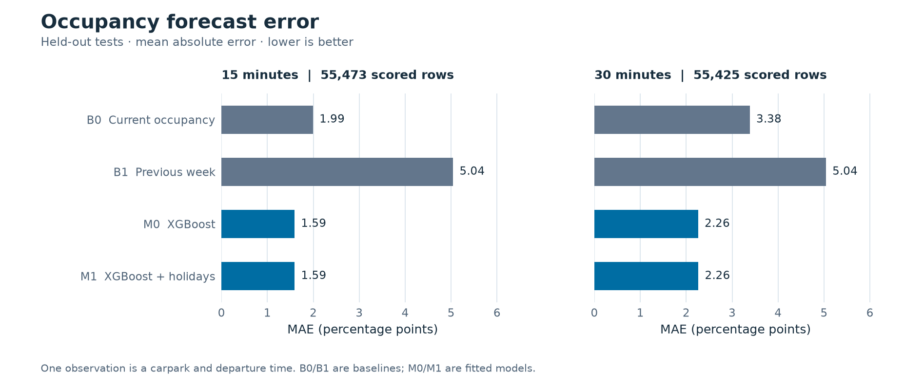
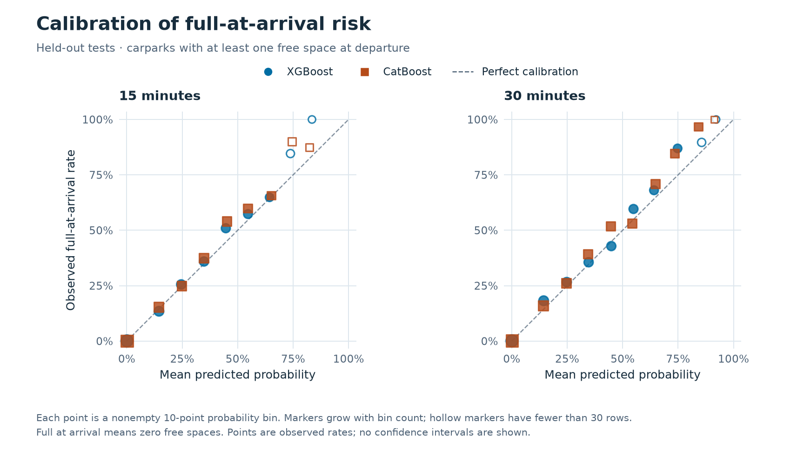
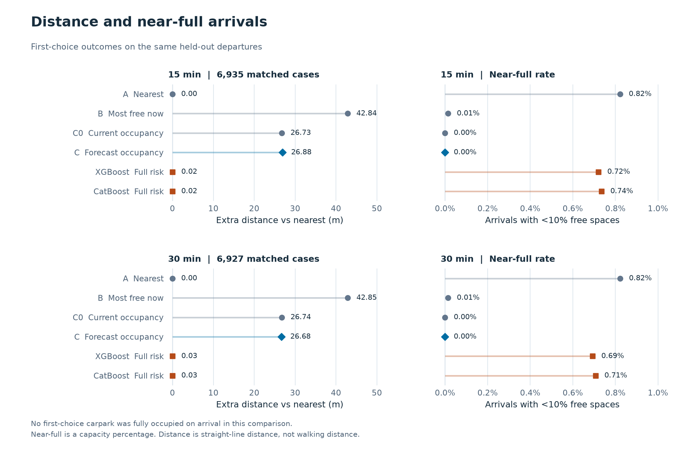

# 牛车水八个停车场年度实验

便于阅读与分享的版本已整理为 [年度测评图文报告](reports/annual/README.md) 和 [PDF 报告](reports/annual/annual_evaluation.pdf)。本页保留年度输入规则、历史结果说明与复现命令。

本次用 `annual_training_8_carparks_segmented(1).csv` 完成 A 的占用率预测、到达风险预测、B 的推荐回放和 C 的独立测试评价。完整流程由 `run_study.py` 一条命令串联。原始年表不随代码或结果包分发。

数据为新加坡时间 2025-11-05 00:00 至 2026-11-04 23:45，共 365 天、8 个停车场、35,040 个 15 分钟时点。280,320 条记录没有重复键。按年表的 5 分钟新鲜度要求，278,557 条可用，1,763 条保留为不可用，不插补。

有效率 **99.37%**。完整网格不等于每一条都有效。无效记录的 46.6% 集中在 2026-03-07 至 03-11。PRM 在 2026-04-20 14:30、14:45、15:00 三条记录中容量从通常的 576 变为 234，需回查源接口或采集日志；本次主分析保留并标注，不擅自修正。CSV 内部一致性检查无法证明采集来源的真实性。

停车场为 KAM、HLM、SLS、PRM、KAS、CSM、TPM、EPM。根据 [HDB 停车场资料](https://data.gov.sg/datasets/d_23f946fa557947f93a8043bbef41dd09/view)和既定 [牛车水地铁站 A 出口](https://data.gov.sg/datasets/d_b39d3a0871985372d7e1637193335da5/view)坐标重算距离，8 个停车场均在 1 公里内，范围为 202.1–994.5 米。年表的 `distance_m` 使用不同的基准点，本次回放不混用。距离是直线距离。

## 时间切分与分段

训练、验证／校准、测试按时间切分为 60/20/20，验证从 2026-06-12 开始，测试从 2026-08-24 开始并覆盖 73 个日期。边界前保留 30 分钟隔离。输入特征从出发时及其之前的有效快照重算；不读取年表的 `target_*` 作为模型特征。滞后与滚动统计不跨连续段。训练、校准和预测评分要求真实到达标签在同一连续段，重建后 15／30 分钟的 278,180／277,847 个合格标签与年表标记和实测空位全部一致。

推荐回放用有效的出发和到达端点衡量策略。若中间 15 分钟快照失效，但 30 分钟到达时的实测端点有效，仍可评分；因此回放和模型评分的分母不必相同。

## A 占用率与到达风险

占用率 MAE，以百分点计，越低越好：

| 模型 | 15 分钟 | 30 分钟 |
| --- | ---: | ---: |
| B0 沿用当前占用率 | 1.992 | 3.384 |
| B1 上周同刻 | 5.042 | 5.041 |
| M0 XGBoost，不含公共假日 | 1.590 | 2.259 |
| M1 XGBoost，含公共假日 | 1.592 | 2.264 |

此表用 C 模块的共同样本重新评分：15／30 分钟各 55,473／55,425 行。B1 在少数时点缺上周快照，因此这里与 A 单模型诊断的分母略有不同。M0 相对 B0 的 MAE 分别降低约 20.1%／33.2%。M1−B0 的配对 MAE 差值为 −0.400／−1.120 个百分点，95% 按日 bootstrap 区间为 [−0.421, −0.379]／[−1.161, −1.077]。

改善并不覆盖所有情况：在真实到达近满样本中，15 分钟 M0／M1 的 MAE 为 1.769／1.775 个百分点，反而高于 B0 的 1.591；30 分钟差异不显著。留出的测试期没有公共假日，不能从这次测试判断假日特征对假日的效果。分场结果见 `forecast_metrics_by_carpark.csv`。



在模型评分中，出发时有位、到达时变满分别为 **345/52,290（0.66%）** 和 **477/52,244（0.91%）**。这是停车场与时点的观测，不是对个别司机的追踪。下表只在这些出发时有位的样本上评价满位概率，Brier 越低越好：

| 模型 | 15 分钟 | 30 分钟 |
| --- | ---: | ---: |
| 沿用当前状态后校准 | 0.006555 | 0.009048 |
| 占用率和容量换算后校准 | 0.004497 | 0.006021 |
| XGBoost 直接预测 | **0.004005** | **0.005192** |
| CatBoost 直接预测 | 0.004060 | 0.005263 |

低余位仍定义为少于 3 个，和空位为 0 的满位分开评分。例如 XGBoost 15 分钟满位预测落在 10%–20% 档的出发有位样本共 334 条，平均预测 14.5%，实际 45/334（13.5%）满位；30 分钟同档为平均预测 14.4%、实际 67/368（18.2%）。概率校准有独立验证段，是否接近实际还要看测试段各档和样本量。

按日配对检验中，XGBoost 的出发有位满位 Brier 相对占用率代理改善约 10.9%／13.8%，两者 Holm 校正 p 值均约 0.0024；XGBoost 与 CatBoost 的对应校正 p 值约 0.452／0.745，不能宣称 XGBoost 显著更好。整体 AUROC 很高并不意味着零风险，主要判断还应结合稀有事件的 Brier、AP 和校准。



## B 推荐与历史回放

验证段按 C0 确定共同距离权重为 0.50。15／30 分钟分别有 **6,935／6,927** 个完整匹配的出发时点。六种策略在两个时长上均无首选到达即满，也没有首选到达剩 0–2 个空位的情况，因此不能据此宣称降低了首选停车失败率。

| 策略 | 15／30 分钟首选近满次数（空位 <10%） | 15／30 分钟平均距目的地 |
| --- | ---: | ---: |
| A 最近 | 57／57 | 202.1／202.1 米 |
| B 当前空位最多 | 1／1 | 245.0／245.0 米 |
| C0 当前占用率＋距离 | 0／0 | 228.8／228.8 米 |
| C 预测占用率＋距离 | 0／0 | 229.0／228.8 米 |
| XGBoost 满位概率＋距离 | 50／48 | 202.1／202.1 米 |
| CatBoost 满位概率＋距离 | 51／49 | 202.1／202.1 米 |

与 C0 相比，C 分别改变了 303／408 次首选，平均距离只变化 +0.15／−0.06 米；直接满位概率策略平均近约 26.7 米，但按百分比衡量的近满次数增加。近满、绝对低余位、真正满位是三个不同口径。73 天内所有首选都没有满位，配对按日重采样的满位率差也始终为 0；这不能证明策略等效。风险预测分数更好，不能自动推出推荐策略的停车结果更好。

原因之一是满位事件的地点分布不均：全年度满位时点的 78.8% 来自只有 26 位的 KAS，测试期间占 88.4%；最近的 KAM 在测试期间一次也没有满位。年表适合研究预测与风险，但这个固定目的地的推荐场景对“减少首选满位”缺乏区分能力。不能为了制造显著性而事后改变目的地或筛选测试时段。



## C 评估交付

[统计方法](EVALUATION.md)与[汇总表及图](examples/annual/evaluation)包含共同样本误差、风险可靠性、配对置信区间和 Holm 校正检验。数据质量按场、按时间段列在 [data_quality](examples/annual/data_quality)。测试中的近满预测、零失败推荐和假日空子集均保留，没有用总体平均数替代这些限制。

## 复现

将 `annual_input` 改成自己的原始年表路径。在模块根目录、已激活 Python 3.11 环境中运行：

```sh
python -m pip install -r requirements-evaluation.txt
annual_input='annual_training_8_carparks_segmented(1).csv'
python run_study.py --history "$annual_input" --holidays data/sg_public_holidays_2020_2027.csv \
  --metadata data/chinatown_annual_carparks.csv --destination data/chinatown_destination.json \
  --output outputs/annual
python -m unittest discover -s tests -v
```

macOS 若缺 `libomp.dylib`，可用 `brew install libomp` 安装 OpenMP。完整逐时点输出留在 `outputs/annual/`；年度结果包包含可运行代码、元数据、汇总 CSV 和三张图。独立复现仍需原始年表。
