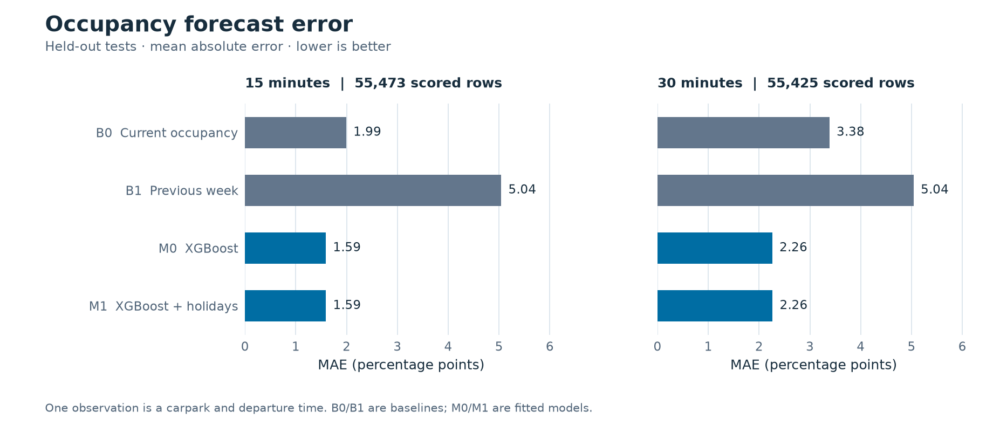

# DS6004 Group 7 · 新加坡停车预测与推荐

围绕牛车水地铁站 A 出口 1 公里内的 8 个停车场，用 15 分钟快照预测未来 15／30 分钟的占用率与到达满位风险，再回放推荐策略、检验实际效果。A、B、C 三个模块已串成完整流程。

**先看结果：[年度测评报告（含图）](reports/annual/README.md) · [下载 PDF 报告](reports/annual/annual_evaluation.pdf)**

| 年度实验概况 | 已验证结果 |
| --- | --- |
| 数据 | 365 天、280,320 行；有效记录占 99.37% |
| 总体占用率预测 | XGBoost M0 相比沿用当前占用率，15／30 分钟 MAE 约降低 20%／33% |
| 到达满位风险 | 直接风险模型优于占用率风险代理；XGBoost 与 CatBoost 没有显著胜负 |
| 推荐回放 | 73 天测试中各策略首选均无满位，**不能据此证明推荐降低失败率或策略等效** |



近满时段的占用率误差并非都改善；测试期没有公共假日；PRM 有 3 条容量突变记录待核实。报告保留这些限制，并提供分停车场结果与数据质量检查。

## 三位同学的模块

| 模块 | 主要工作 | 入口与说明 |
| --- | --- | --- |
| A · Forecasting | B0/B1/M0/M1 占用率预测；XGBoost、CatBoost 直接预测到达满位与低余位概率；独立时间段校准 | [`forecast.py`](forecast.py)、[`forecast_risk.py`](forecast_risk.py)；[预测方法](docs/forecasting.md)、[风险目标](RISK_MODEL.md) |
| B · Recommendation | 最近、当前空位最多、当前占用率与预测占用率策略，以及直接风险策略的匹配回放 | [`recommendation.py`](recommendation.py)；[推荐方法](RECOMMENDATION.md) |
| C · Evaluation | 共同样本误差、风险校准、推荐结果和距离；按日配对置信区间与检验 | [`evaluate.py`](evaluate.py)；[评估口径](EVALUATION.md) |

## 跑完整年度实验

需要 **Python 3.11**。先从组内获取约 90 MB 的原始年表 `annual_training_8_carparks_segmented(1).csv`，放在仓库根目录，或将下面的 `--history` 改成文件路径。仓库提供代码、元数据和汇总结果；原始年表未公开上传。

在仓库根目录运行：

```sh
python3 -m venv .venv
source .venv/bin/activate
python -m pip install -r requirements-evaluation.txt
python run_study.py --history 'annual_training_8_carparks_segmented(1).csv' \
  --holidays data/sg_public_holidays_2020_2027.csv \
  --metadata data/chinatown_annual_carparks.csv \
  --destination data/chinatown_destination.json \
  --output outputs/annual
```

Windows 使用 `.venv\Scripts\Activate.ps1` 激活环境，并将运行命令写成一行。macOS 若提示缺少 `libomp.dylib`，先运行 `brew install libomp`。

结果写入 `outputs/annual/` 下的 `forecast/`、`risk/`、`recommendation/`、`evaluation/`。这些本地输出不自动提交到 GitHub。年度输入规则与时间切分见 [ANNUAL_RUN.md](ANNUAL_RUN.md)。

## 在哪里找文件

| 位置 | 用途 |
| --- | --- |
| [`reports/`](reports/README.md) | 面向组员阅读的测评报告、PDF 与图表 |
| [`examples/annual/`](examples/annual/README.md) | 已运行的年度汇总 CSV、审计和统计结果，供核对报告数字 |
| [`docs/forecasting.md`](docs/forecasting.md) | A 模块特征、输入输出字段与旧 pilot 说明 |
| [`data/`](data/) | 小规模 pilot、假日、停车场和目的地元数据 |
| [`tests/`](tests/) | 数据时序、风险定义、推荐匹配与统计检查 |
| [`scripts/`](scripts/) | 从年度汇总重新生成报告图和 PDF，见 [报告构建说明](reports/README.md#重新生成图与-pdf) |
| `outputs/` | 本机重跑生成的预测明细、模型和结果（Git 忽略） |

旧 [`examples/pilot/`](examples/pilot/) 与 [`examples/chinatown_recommendation/`](examples/chinatown_recommendation/) 是短期试采和流程检查，不能替代年度实验结论。

## 验证与数据来源

当前版本 **41 项测试通过**。运行检查：

```sh
python -m unittest discover -s tests -v
```

数据基础为 [HDB 停车位可用性](https://data.gov.sg/datasets/d_ca933a644e55d34fe21f28b8052fac63/view)、[HDB 停车场资料](https://data.gov.sg/datasets/d_23f946fa557947f93a8043bbef41dd09/view)与 [MOM 公共假日](https://data.gov.sg/datasets/d_8ef23381f9417e4d4254ee8b4dcdb176/view)。年度 CSV 由组内提供；其来源与异常仍需原始快照、采集日志支持，详见 [数据质量说明](examples/annual/data_quality/README.md)。
