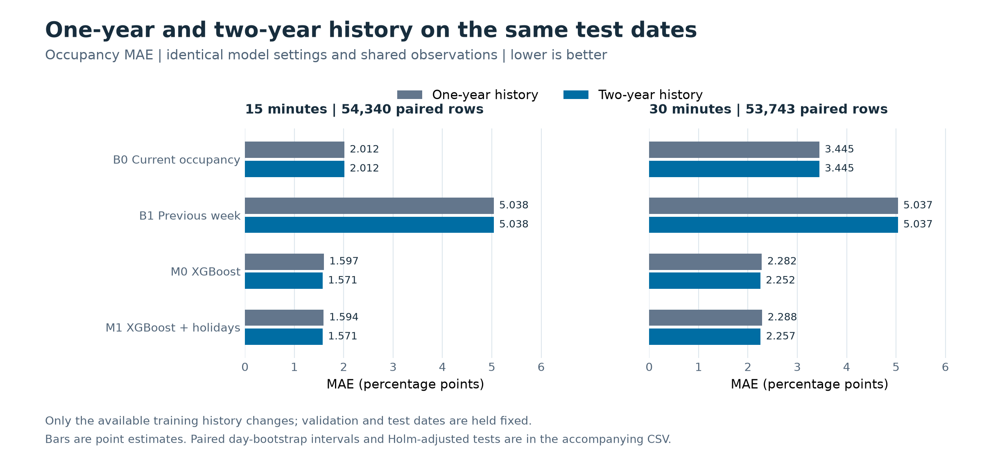

# DS6004 Group 7 · 新加坡停车预测与推荐

围绕牛车水地铁站 A 出口 1 公里内的 8 个停车场，用 15 分钟快照预测未来 15／30 分钟的占用率与到达满位风险，再回放推荐策略、检验实际效果。A、B、C 三个模块已串成完整流程。

**最新结果：[一年与两年对比报告（含图）](reports/history_comparison/README.md) · [下载 6 页 PDF](reports/history_comparison/history_comparison.pdf)**

| 最新修正版数据实验 | 已验证结果 |
| --- | --- |
| 数据 | 730 天、560,637 行；有效记录占 98.03% |
| 一年 vs 两年 | 固定同一 73 天测试期；两年历史使 M0 / M1 的 MAE 下降约 1.3%-1.7%，Holm p 约 0.0012 |
| 风险与推荐 | 历史长度增加后没有显著改善，不能宣称完整流程全面胜出 |
| 标准两年运行 | 另外完成 60/20/20 全流程，146 天测试；直接风险模型优于占用率代理，XGBoost 与 CatBoost 满位 Brier 无显著胜负 |



一年对照从最新两年修正版截取后重新训练，排除旧数据清洗差异。共享测试期无公共假日；标准两年测试期有 2 个。新文件已去除旧 PRM 的 3 条容量异常记录，采集与修正过程仍需原始快照、日志支持。

旧版年表的 [年度报告](reports/annual/README.md) 与 [年度汇总](examples/annual/README.md) 保留作历史记录，不能直接用来判断历史长度的效果。

## 三位同学的模块

| 模块 | 主要工作 | 入口与说明 |
| --- | --- | --- |
| A · Forecasting | B0/B1/M0/M1 占用率预测；XGBoost、CatBoost 直接预测到达满位与低余位概率；独立时间段校准 | [`forecast.py`](forecast.py)、[`forecast_risk.py`](forecast_risk.py)；[预测方法](docs/forecasting.md)、[风险目标](RISK_MODEL.md) |
| B · Recommendation | 最近、当前空位最多、当前占用率与预测占用率策略，以及直接风险策略的匹配回放 | [`recommendation.py`](recommendation.py)；[推荐方法](RECOMMENDATION.md) |
| C · Evaluation | 共同样本误差、风险校准、推荐结果和距离；按日配对置信区间与检验 | [`evaluate.py`](evaluate.py)；[评估口径](EVALUATION.md) |

## 复现最新三组实验

需要 **Python 3.11**。从组内获取约 190 MB 的 `two_year_training_corrected_proposal.csv`，将下面的 `--history` 指向实际路径。仓库提供代码、元数据和汇总结果；原始大表未公开上传。

在仓库根目录运行：

```sh
python3 -m venv .venv
source .venv/bin/activate
python -m pip install -r requirements-evaluation.txt
python scripts/run_history_comparison.py \
  --history 'two_year_training_corrected_proposal.csv' \
  --output outputs/history_comparison
```

Windows 使用 `.venv\Scripts\Activate.ps1` 激活环境，并将运行命令写成一行。macOS 若提示缺少 `libomp.dylib`，先运行 `brew install libomp`。

脚本依次运行 `one_year`、`two_year_shared`、`two_year_standard`，每组均包含预测、风险、推荐和评估，然后生成 `comparison/` 的配对统计与两张图。原始数据、模型和逐时点输出留在本机，Git 忽略。只准备一年子集和实验清单可加 `--prepare-only`。

只重算已有预测的历史长度对比、或单独运行标准两年实验，见 [复现与结果索引](examples/history_comparison/README.md)。旧年度运行说明见 [ANNUAL_RUN.md](ANNUAL_RUN.md)。

## 在哪里找文件

| 位置 | 用途 |
| --- | --- |
| [`reports/`](reports/README.md) | 面向组员阅读的测评报告、PDF 与图表 |
| [`examples/history_comparison/`](examples/history_comparison/README.md) | 最新三组汇总、历史长度配对比较、审计和软件版本 |
| [`examples/annual/`](examples/annual/README.md) | 旧版年度数据的历史结果 |
| [`docs/forecasting.md`](docs/forecasting.md) | A 模块特征、输入输出字段与旧 pilot 说明 |
| [`data/`](data/) | 小规模 pilot、假日、停车场和目的地元数据 |
| [`tests/`](tests/) | 数据时序、风险定义、推荐匹配与统计检查 |
| [`scripts/`](scripts/) | 历史长度实验、配对比较及 PDF 导出，见 [报告构建说明](reports/README.md) |
| `outputs/` | 本机重跑生成的预测明细、模型和结果（Git 忽略） |

旧 [`examples/pilot/`](examples/pilot/) 与 [`examples/chinatown_recommendation/`](examples/chinatown_recommendation/) 是短期试采和流程检查，不能替代年度实验结论。

## 验证与数据来源

当前版本 **43 项测试通过**。运行检查：

```sh
python -m unittest discover -s tests -v
```

数据基础为 [HDB 停车位可用性](https://data.gov.sg/datasets/d_ca933a644e55d34fe21f28b8052fac63/view)、[HDB 停车场资料](https://data.gov.sg/datasets/d_23f946fa557947f93a8043bbef41dd09/view)与 [MOM 公共假日](https://data.gov.sg/datasets/d_8ef23381f9417e4d4254ee8b4dcdb176/view)。两年 CSV 由组内提供；其来源仍需原始快照、采集日志支持，详见 [最新数据质量说明](examples/history_comparison/data_quality/README.md)。
