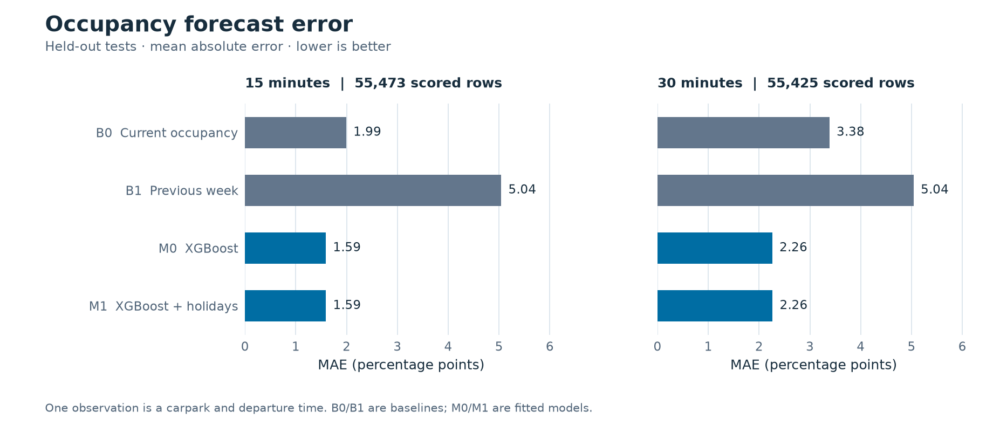
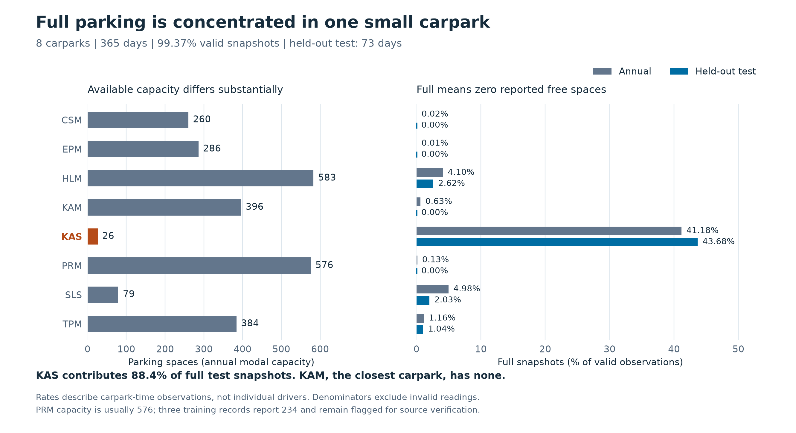
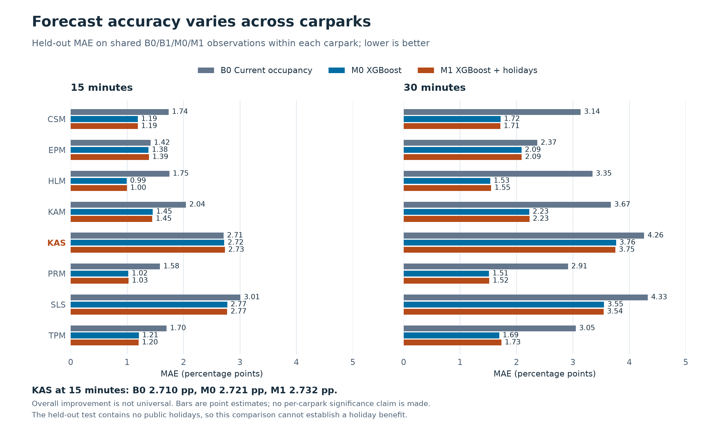
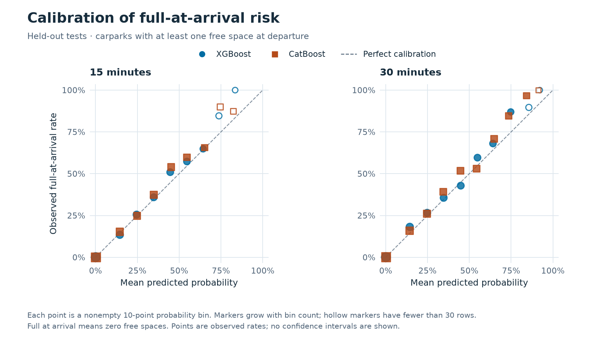
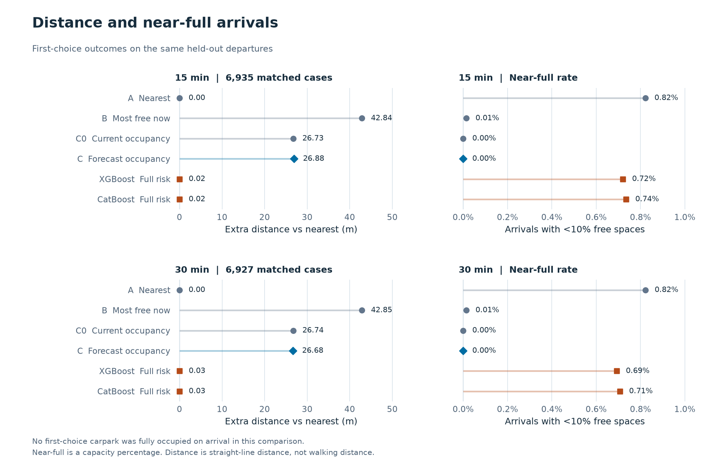

# 年度停车预测与推荐测评报告

[下载 PDF](annual_evaluation.pdf) · [项目首页](../../README.md) · [指标汇总](../../examples/annual/evaluation)

DS6004 Group 7 · 新加坡牛车水 · 年度模型运行：2026-11-06

## 01 / 结果概览

> 总体预测更准确，但本次回放尚不能证明推荐降低了停车失败率。

**8 个停车场 · 365 天数据 · 73 个留出测试日期**

A 负责占用率与到达风险预测，B 根据预测和距离推荐停车场，C 使用真实到达快照评价结果。A → B → C 全流程已完成，41 项测试通过。数据覆盖 2025-11-05 至 2026-11-04，预测未来 15 / 30 分钟。

| 时长 | 共同测试样本 | B0 MAE | M0 MAE | M1 MAE |
| --- | --- | --- | --- | --- |
| 15 分钟 | 55,473 | 1.992 | 1.590 | 1.592 |
| 30 分钟 | 55,425 | 3.384 | 2.259 | 2.264 |

MAE 的单位为占用率百分点，不能解释为车位数。B0 沿用当前占用率，B1 使用上周同刻，M0 是 XGBoost，M1 额外加入假日标记。四者在共同可评分样本上比较。

M0 相对 B0 的总体 MAE 在 15 / 30 分钟分别降低约 **20.1% / 33.2%**。直接预测满位风险也优于占用率风险代理；但推荐首选满位次数均为零，不能直接把预测进步解释为推荐收益。

[核对预测指标](../../examples/annual/evaluation/forecast_metrics.csv)

## 02 / 数据覆盖好，风险分布不均

> 有效记录占 99.37%，但大多数满位快照来自只有 26 个车位的 KAS。

8 个停车场各有 35,040 个 15 分钟时点，共 **280,320 行**。无重复键，时间网格完整；按源文件 5 分钟时效及有效性规则，278,557 行可用，1,763 行不可用，不插补。

| 质量检查 | 发现与处理 |
| --- | --- |
| 缺测集中性 | 无效记录的 46.6% 集中于 2026-03-07 至 03-11 |
| 事件集中性 | KAS 贡献全年满位快照的 78.81%，测试期占 88.45% |
| 容量待核实 | PRM 的 3 条记录容量从通常 576 变为 234，保留并标注 |
| 推荐场景 | 最近目的地的 KAM 在整个测试期没有满位 |

PRM 的异常时间为 2026-04-20 的 14:30、14:45、15:00，空位分别为 0 / 233 / 232。源文件仍标有效，主分析未删除，也未验证删除后的敏感性；需回查源接口或原始快照。

CSV 内部一致性不能独立证明官方采集来源，仍需原始快照与采集日志。网格完整也不等于每一条数据都可用于训练。

[数据审计与异常明细](../../examples/annual/data_quality/README.md)

## 03 / 整体提升不能代替分场检查

> 多数停车场误差下降；KAS 的 15 分钟预测和近满子集仍有不足。

| 评价子集 | B0 MAE | M0 MAE | M1 MAE |
| --- | --- | --- | --- |
| KAS，15 分钟 | 2.710 | 2.721 | 2.732 |
| 所有场近满时点，15 分钟 | 1.591 | 1.769 | 1.775 |

单位为占用率百分点。真实到达近满子集的 15 分钟 M0 / M1 MAE 反而高于 B0（按日配对检验、Holm 校正 p 约 0.0018）；30 分钟差异不显著。不能写成“高风险时段也全面更准”。按场柱图是描述性对比，不代表每个场的差异都显著。

M1 加入了公共假日标记，但测试期恰好没有公共假日。不能用这次 M0 / M1 的差异推断假日特征在假日期间是否有效。

模型评分要求出发点和真实到达标签位于同一连续有效段。分场图在每个停车场内使用模型共同样本。73 个留出测试日期不能代表所有季节，也没有检验新的停车场。

[分场预测指标](../../examples/annual/evaluation/forecast_metrics_by_carpark.csv) · [配对误差比较](../../examples/annual/evaluation/paired_forecast_comparisons.csv)

## 04 / 直接预测到达满位风险

> 回应老师问题 2：出发时还有位，到达时会不会变成无位？

15 / 30 分钟风险评分分别包含 **52,290 / 52,244** 个出发时有位的停车场与时点，其中到达满位 **345 / 477 次（0.660% / 0.913%）**。校准只使用独立验证段，下图与指标来自测试段。

| 满位概率模型 | 15 分钟 Brier | 30 分钟 Brier | 15 / 30 分钟 AP |
| --- | --- | --- | --- |
| 占用率风险代理 | 0.004497 | 0.006021 | 0.492 / 0.529 |
| XGBoost 直接风险 | 0.004005 | 0.005192 | 0.566 / 0.619 |
| CatBoost 直接风险 | 0.004060 | 0.005263 | 0.558 / 0.614 |

Brier 衡量概率与实际事件的平方误差，越低越好；AP 概括稀有事件的精确率与召回率表现，越高越好。各模型在相同的出发有位样本上评分。

XGBoost 相对占用率风险代理的 Brier 改善约 **10.9% / 13.8%**（Holm p 均约 0.0024）。XGBoost 与 CatBoost 的校正 p 值为 **0.452 / 0.745，没有显著胜出**。

分箱为固定 10 个百分点宽的概率区间，不是等频分位数。15 分钟 XGBoost 的 10%-20% 档共 334 条，平均预测 14.5%，实际满位 13.5%；30 分钟同档 368 条，平均预测 14.4%，实际 18.2%。高概率档样本较少，图上未画置信区间。

[风险评分](../../examples/annual/evaluation/risk_probability_metrics.csv) · [校准分箱](../../examples/annual/evaluation/risk_reliability.csv)

## 05 / 推荐呈现距离与近满的权衡

> 六种策略的首选满位均为 0，首选少于 3 个空位也均为 0；不能据此宣称降低失败。

固定牛车水地铁站 A 出口为目的地，8 场均在 1 公里内。共同距离权重 0.50 由验证段选择。15 / 30 分钟各有 **6,935 / 6,927** 个匹配出发时点，各策略使用相同候选集合和真实到达快照。

| 策略 | 15 / 30 分钟近满次数 | 15 / 30 分钟平均距离（米） |
| --- | --- | --- |
| A 最近 | 57 / 57 | 202.11 / 202.11 |
| B 当前空位最多 | 1 / 1 | 244.95 / 244.96 |
| C0 当前占用率 | 0 / 0 | 228.85 / 228.85 |
| C 预测占用率 | 0 / 0 | 228.99 / 228.79 |
| XGBoost 满位风险 | 50 / 48 | 202.14 / 202.15 |
| CatBoost 满位风险 | 51 / 49 | 202.13 / 202.15 |

C 相对 C0 改变 303 / 408 次首选，平均距离只变化 +0.15 / -0.06 米，区间均跨零。相对 C0，满位风险策略平均近约 26.7 米，却出现更多按比例定义的近满。风险概率更准并不自动意味着推荐结果更好。

[推荐指标](../../examples/annual/evaluation/recommendation_metrics.csv) · [配对策略比较](../../examples/annual/evaluation/paired_policy_comparisons.csv)

## 06 / 评估边界、复现与组内分工

### 严格区分三个到达事件

| 事件 | 定义 | 用途 |
| --- | --- | --- |
| 真正满位 | 到达空位 = 0 | 首选停车失败的快照代理 |
| 安全余量不足 | 到达空位 < 3 | 绝对余位预警 |
| 近满 | 到达空位 < 容量的 10% | 与 proposal 对应的比例指标 |

这些是停车场状态观测，不是对个别司机的追踪。Top3 可行率指同一到达时刻的前三场至少一场有位，未模拟依次驾车寻找和额外行驶时间。距离为直线距离，不等同于步行路线。

模型的样本单位为“停车场 × 出发时点”，推荐的样本单位为“一个出发时点的一组候选”。模型要求同一有效连续段，推荐按有效出发、到达端点回放，因此两者分母不同。

### 时间切分与统计

按时间分为训练 / 验证 / 测试约 60% / 20% / 20%。验证从 2026-06-12 开始，测试为 2026-08-24 至 2026-11-04；两个边界前各隔离 30 分钟，训练标签不跨入后续分段。训练 / 验证 / 测试的公共假日日期数为 10 / 2 / 0。

C 比较相同样本上的损失或策略结果。以新加坡决策日期为整块，成对重采样 10,000 次，报告 95% percentile bootstrap 区间；双侧按日符号翻转检验的 p 值在每张比较表内做 Holm 校正，区间不做多重校正。

按日抽样保留日内相关性，但把日期块视作可交换；符号检验假定日期独立且零假设下差值对称，跨日依赖可能影响近似。全零配对差值不输出可误读为等效证明的区间或 p 值。

### 完整交付与复现

| 人员 / 模块 | 程序入口 | 本次输出 |
| --- | --- | --- |
| A 预测 | forecast.py / forecast_risk.py | 占用率、满位概率与低余位概率 |
| B 推荐 | recommendation.py | A / B / C0 / C 与两种风险策略 |
| C 评估 | evaluate.py | 误差、校准、配对统计及图表 |
| 完整流程 | run_study.py | 一次运行串联 A、B、C |

原始年度 CSV 及逐时点大表未公开上传，组员需自行放置原始年表。报告基于 examples/annual 的汇总表，图表与 PDF 构建脚本随仓库保存。未来应先核实容量异常与采集来源，再预先设计含假日、高需求日期或多个目的地的新验证，不能事后挑选有利测试场景。

[项目首页与运行命令](../../README.md) · [详细统计方法](../../EVALUATION.md) · [软件版本](../../examples/annual/run_environment.json)

分析版本：7ef91e1；模型运行日：2026-11-06。本次仅整理报告与展示，没有重训或选择新的测试结果。
