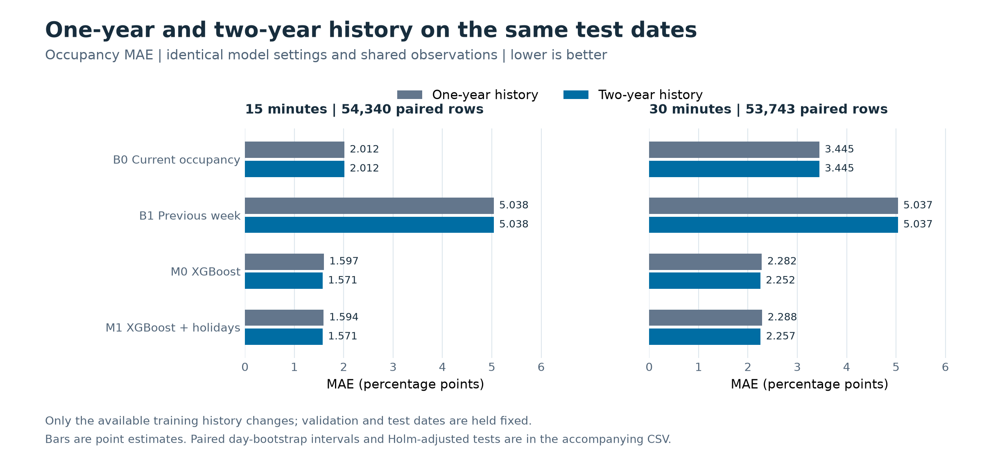
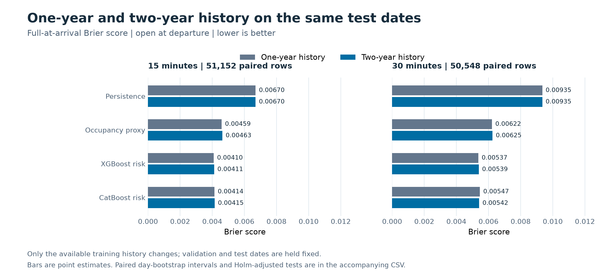
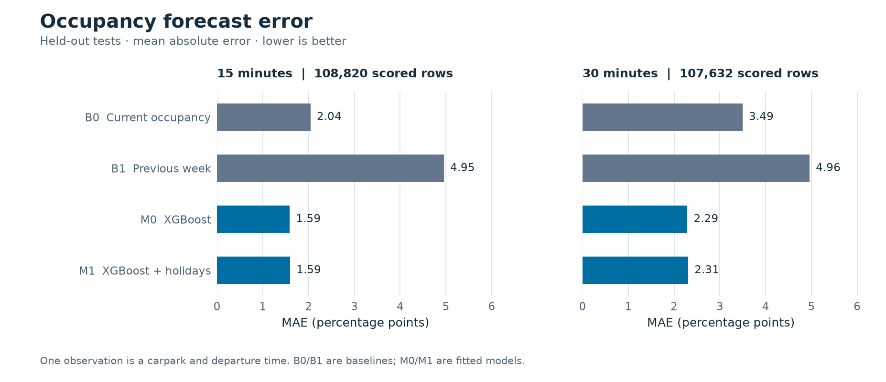
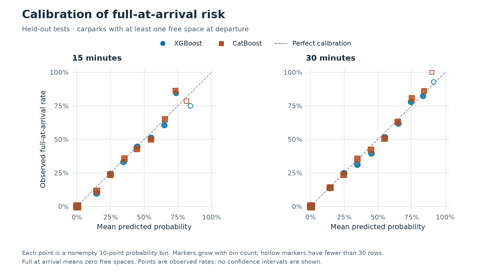
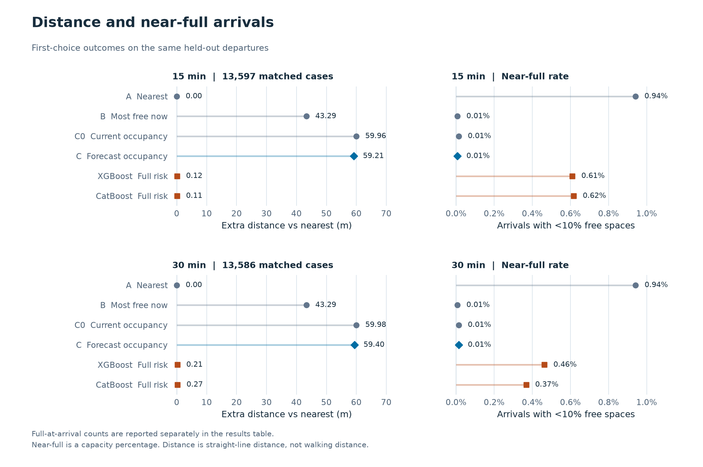

# 一年与两年数据对比测评

[下载 PDF](history_comparison.pdf) · [项目首页](../../README.md) · [完整结果索引](../../examples/history_comparison/README.md)

DS6004 Group 7 · 新加坡牛车水 8 个停车场 · 2026-11-06

## 01 / 两年历史小幅改善占用率预测

> 相同测试期内，两年历史使 M0 / M1 的 MAE 降低约 1.3%-1.7%；风险预测与推荐尚无显著改善。

新文件覆盖 2024-11-05 至 2026-11-04。我们从这份修正版中截取最近一年，重新运行一年、两年共享测试期、两年标准切分三组 A → B → C，避免把旧数据清洗差异误当成历史长度效果。

| 公平比较设置 | 最近一年 | 两年历史 |
| --- | --- | --- |
| 训练日期数 | 219 | 584 |
| 共同验证段 | 2026-06-12 至 08-23，73 天 | 相同 |
| 共同测试段 | 2026-08-24 至 11-04，73 天 | 相同 |

M0 为 XGBoost；M1 额外加入假日标记。15 / 30 分钟的 M0 MAE 从 **1.5970 / 2.2823** 降至 **1.5706 / 2.2519** 个百分点，相对降低 **1.65% / 1.34%**。M1 分别降低 1.44% / 1.39%；四项按日配对检验的 Holm 校正 p 均约 0.0012。

共同可评分样本为 54,340 / 53,743 个停车场与时点。模型、特征、超参数与验证日期固定；只有训练历史向前扩展。两年共享切分约为 80% / 10% / 10%，专用于历史长度实验；proposal 的标准 60% / 20% / 20% 另行运行。

[配对预测统计](../../examples/history_comparison/comparison/forecast_history_comparison.csv) · [对齐审计](../../examples/history_comparison/comparison/audit.json)

## 02 / 更多历史没有带来全面提升

> “占用率更准”与“到达时能停到”是两个问题，需要分别检验。

| 满位概率模型 | 时长 | 一年 Brier | 两年 Brier |
| --- | --- | --- | --- |
| XGBoost | 15 分钟 | 0.004096 | 0.004115 |
| XGBoost | 30 分钟 | 0.005368 | 0.005394 |
| CatBoost | 15 分钟 | 0.004137 | 0.004149 |
| CatBoost | 30 分钟 | 0.005466 | 0.005418 |

以上四项的 Holm 校正 p 均为 1；全部历史长度风险比较均未达到校正后 p < 0.05。数值有升有降，不能据此宣称两年风险模型更好，也不能解释为两者等效。两种历史长度都使用独立时间验证段校准，测试段只评分。

推荐回放也使用相同出发时点、候选场、目的地和距离权重 0.50。15 / 30 分钟分别有 6,794 / 6,786 个匹配场景；两组所有策略的首选满位与少于 3 个空位次数都为 0。两年策略 C 的平均距离只减少约 0.15 / 0.42 米，未通过多重校正；全部策略的历史长度差异均无统计显著性。

共同测试期没有公共假日，最近场 KAM 本身也没有满位。近满子集的占用率误差随历史增加而下降，但 15 分钟 M0 / M1 仍略逊于当前状态 B0；局部预测提升不等于停车失败率下降。

[风险配对统计](../../examples/history_comparison/comparison/risk_history_comparison.csv) · [策略配对统计](../../examples/history_comparison/comparison/policy_history_comparison.csv)

## 03 / 完整两年按 proposal 独立测评

> 标准 60% / 20% / 20% 运行保留 146 个测试日期；这组分数不能直接拿来比较一年与两年。

标准两年运行按时间分为 438 天训练、146 天验证、146 天测试。验证从 2026-01-17 开始，测试从 2026-06-12 开始；两个边界前各隔离 30 分钟。测试结束于 2026-11-04。

| 预测时长 | 共同测试样本 | B0 MAE | M0 MAE | M1 MAE |
| --- | --- | --- | --- | --- |
| 15 分钟 | 108,820 | 2.0409 | 1.5859 | 1.5930 |
| 30 分钟 | 107,632 | 3.4949 | 2.2882 | 2.3061 |

单位为占用率百分点。M0 相比当前状态 B0 的总体误差分别降低约 **22.3% / 34.5%**。这回答“模型是否优于基准”，第 1 页才回答“增加历史是否有帮助”。

本组测试期有 2 个公共假日日期，假日共同样本为 1,504 / 1,488 条。假日子集 M0 的 MAE 为 1.8063 / 2.6037，M1 为 1.7820 / 2.5248 个百分点。只有两个日期，结果只作描述，尚不足以证明加入假日特征具有稳定收益。

历史长度实验与标准两年实验的测试日期、训练日期、校准段和推荐权重不同，不应按数字大小横向排名。M0 / M1、XGBoost / CatBoost 均事先保留，未根据测试结果重新调参。

[标准两年预测指标](../../examples/history_comparison/two_year_standard/evaluation/forecast_metrics.csv) · [分停车场指标](../../examples/history_comparison/two_year_standard/evaluation/forecast_metrics_by_carpark.csv)

## 04 / 回应老师：预测到达无位风险

> 分开建模真正满位与安全余量不足，并在未参与训练的时间段校准概率。

标准两年测试的出发有位样本为 102,649 / 101,451 条，15 / 30 分钟后满位分别发生 733 / 1,015 次。以下比较只在相同样本上进行，不把出发时已满的情况混入主要风险评分。

| 模型 | 15 分钟 Brier | 30 分钟 Brier | 15 / 30 分钟 AP |
| --- | --- | --- | --- |
| 占用率风险代理 | 0.004991 | 0.006708 | 0.472 / 0.516 |
| XGBoost 直接风险 | 0.004481 | 0.005734 | 0.527 / 0.605 |
| CatBoost 直接风险 | 0.004505 | 0.005756 | 0.525 / 0.601 |

XGBoost 相对占用率风险代理的 Brier 降低约 **10.2% / 14.5%**，Holm p 均约 0.0024；XGBoost 与 CatBoost 的满位 Brier 差异未达显著性。AP 越高越好，但不能替代概率校准。

真正满位定义为到达空位 = 0；安全余量不足定义为到达空位 < 3；proposal 的近满定义为空位 < 容量的 10%。三个事件分别输出，不能把预警事件算成真实失败。校准图采用固定 10 个百分点分箱；空心点少于 30 条，高概率档稀少，未画置信区间。

[风险指标与低余位结果](../../examples/history_comparison/two_year_standard/evaluation/risk_probability_metrics.csv) · [校准分箱](../../examples/history_comparison/two_year_standard/evaluation/risk_reliability.csv)

## 05 / 推荐的距离与安全余量权衡

> 完整两年回放观察到策略差异，但还不能据此宣称预测策略降低了真实司机的失败率。

目的地为牛车水地铁站 A 出口，8 场在 1 公里内；验证段选定距离权重 0.25。下表 visitor_eligible 按访客开放时间和完整观测筛选，可包含出发时已满的候选；15 / 30 分钟有 13,597 / 13,586 个匹配出发时点。

| 策略 | 15 / 30 分钟满位次数 | 15 / 30 分钟近满次数 | 平均距离（米，15 / 30） |
| --- | --- | --- | --- |
| A 最近 | 28 / 28 | 128 / 128 | 202.11 / 202.11 |
| B 当前空位最多 | 0 / 0 | 1 / 1 | 245.40 / 245.41 |
| C0 当前占用率 | 1 / 2 | 2 / 2 | 262.08 / 262.10 |
| C 预测占用率 | 1 / 2 | 1 / 2 | 261.32 / 261.51 |
| XGBoost 满位风险 | 0 / 0 | 83 / 63 | 202.23 / 202.32 |
| CatBoost 满位风险 | 0 / 1 | 84 / 50 | 202.22 / 202.39 |

A 的 28 次满位只集中在 8 月 16 日和 18 日；open_at_departure 再排除出发时已满的候选后，A 的到达满位为 4 / 7 次。因此 28 与 0 的差别不能全部归功于预测了途中变化。

C 相比 C0 的满位次数相同；直接风险策略相较 C0 距离约少 60 米，但近满率更高，两项 Holm p 均约 0.0038，满位差异不显著。这是固定两年数据下的策略权衡，与第 2 页历史长度比较不同。

[两种候选口径与全部指标](../../examples/history_comparison/two_year_standard/evaluation/recommendation_metrics.csv) · [配对统计](../../examples/history_comparison/two_year_standard/evaluation/paired_policy_comparisons.csv)

## 06 / 数据修正、统计边界与交付

### 新数据质量

| 核查项 | 结果 |
| --- | --- |
| 覆盖 | 730 天，560,637 行，8 个停车场，无重复键 |
| 可用记录 | 549,569 行，占 98.03%；无效行 11,068，不插补 |
| 缺少网格 | 3 条，正是旧年表中 PRM 的容量异常时点 |
| 标签核对 | 重算 15 / 30 分钟可评分标签，与输入标签一致 |
| 时间核对 | 有效行无未来更新时间，距决策时刻不超过 300 秒 |

新文件中最近一年为 280,317 行、275,649 行有效；旧年表为 280,320 行、278,557 行有效。共有 2,905 条原有效行改为无效；1,856 条空位值发生变化，但全部属于新文件无效行。因此旧年度报告保留为历史记录，本次一年对照必须从新文件重跑。

所有 snapshot_time 都与决策时刻相同，来源字段统一为 api/data.gov.sg。以上仅验证 CSV 内部一致性，仍需原始 JSON 快照和修正日志确认采集与修正过程。缺少的 PRM 时点为 2026-04-20 14:30、14:45、15:00，不插补跨段训练。

### 评估口径

预测按“停车场 × 出发时点”评分，要求标签处于同一连续有效段；推荐按一个出发时点的候选集合评分，检查有效出发和到达端点。推荐结果是历史快照回放，不是实际司机追踪；距离为直线距离，Top3 可行率也不模拟依次寻位的额外时间。

配对统计以新加坡日期为整块，重采样 10,000 次，输出 95% percentile bootstrap 区间；双侧按日符号翻转 p 值在各比较 CSV 内做 Holm 校正，区间未做多重校正。日期块被视为可交换，检验假定日间独立、零假设下日差值对称；跨日依赖未建模。全零差异不输出可被误读为等效证明的区间或 p 值。

### 组员使用与结论

建议把完整两年标准运行作为 proposal 主测评，把同测试期的一年与两年实验作为补充消融。可以说“两年训练历史小幅改善占用率 MAE”；不能说“更多数据已经全面改善停车风险与推荐”。下一步应在预先确定的新日期、多个目的地和高需求场景继续检验。

仓库保留三组汇总、统计表、审计、5 张报告图与 PDF，A / B / C 一键运行及比较脚本齐全。原始大表、逐时点预测和模型在本地，未公开上传。完整数据复现入口为 scripts/run_history_comparison.py；43 项测试通过。

[复现命令与结果文件](../../examples/history_comparison/README.md) · [数据审计](../../examples/history_comparison/data_quality/README.md) · [实验清单](../../examples/history_comparison/experiment_manifest.json) · [软件版本](../../examples/history_comparison/run_environment.json)
