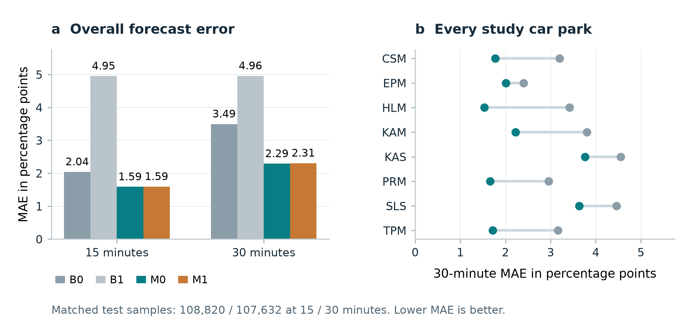
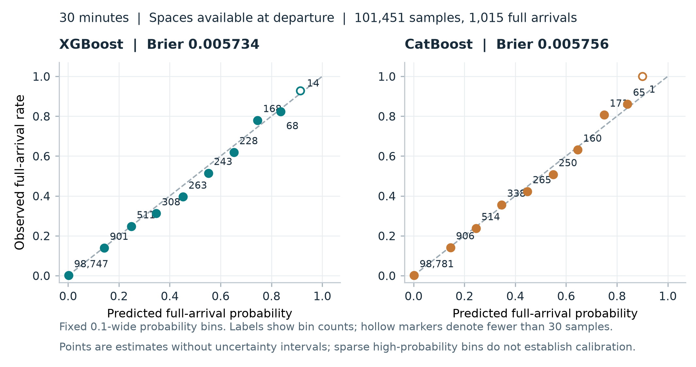

# Parking Occupancy and Arrival Risk Modelling

DS6004 Group 7

Model development and experimental results for the final group report

13 November 2026

## 1 Modelling objectives and experimental setting

We developed short-horizon models for eight HDB car parks near Chinatown MRT Exit A to estimate the conditions a driver may encounter after departure. The modelling component provides occupancy forecasts and separate probabilities of finding no free spaces or an insufficient absolute spare-space margin. It addresses RQ1 through a public-holiday feature ablation and supplies the predictions used in the RQ2 and RQ3 recommendation experiments. The principal finding is that boosted models improve forecast error and probability scores, while their additional benefit for parking recommendations remains limited in this study.

### Data interface and prediction targets

The experiments use the corrected two-year file described in the data section [1]: 560,637 records covering 5 November 2024 to 4 November 2026, with 549,569 valid observations. We apply its strict 300-second freshness rule, keep invalid observations missing and reconstruct features and targets from the underlying observations. Precomputed future-target columns are not used as predictors. All times are interpreted in Singapore time.

Table 1  Outcomes predicted or evaluated at exactly 15 and 30 minutes after departure

| Outcome | Definition at arrival | Role |
| --- | --- | --- |
| Occupancy | One minus available car spaces divided by capacity | Continuous regression target |
| Full | Zero available car spaces | Primary binary arrival-risk target |
| Low spare-space margin | Fewer than 3 available spaces, including zero | Separate binary warning target |
| Near full | Available spaces below 10% of capacity, including full | Proposal-defined threshold evaluation |

The absolute low-margin target is an extension to address departure-to-arrival uncertainty. It differs from the data file’s supplementary fewer-than-5 and fewer-than-10 fields. Near-full status and low margin are warning conditions, not interchangeable definitions of parking failure. A full label describes the observed car park state, not a tracked individual driver outcome.

### Chronological separation

Table 2  Standard two-year experiment used for the main results

| Partition | Dates | Calendar days | Holiday dates |
| --- | --- | --- | --- |
| Training | 5 Nov 2024 to 16 Jan 2026 | 438 | 14 |
| Validation | 17 Jan to 11 Jun 2026 | 146 | 8 |
| Test | 12 Jun to 4 Nov 2026 | 146 | 2 |

Decision origins in the 30 minutes before each partition boundary are excluded. For model fitting and forecast or probability evaluation, eligible targets must lie in the same partition and uninterrupted valid segment as the origin; a 30-minute target also requires the intermediate record. No unknown target is interpolated. Models remain fixed during testing, although each new forecast uses observations available by its decision time. The main test is separate from the supplementary windows in Section 6 [2].

<!-- PAGE -->

## 2 Feature engineering and occupancy models

### Features available at the decision time

We fit one pooled model for each horizon, using all eight car parks and indicators for car park identity. Historical features are computed separately within each car park. Exact-timestamp matching and segment checks prevent a lag or target from bridging a missing or invalid interval. Calendar attributes describe the future arrival slot and are known when the prediction is made.

Table 3  Feature groups used by the occupancy regressors

| Group | Inputs | Availability rule |
| --- | --- | --- |
| Current state | Occupancy, capacity and observation age | Valid departure observation only |
| Recent history | Occupancy at 15, 30, 45 and 60 minutes before departure | Exact timestamp in the same valid segment |
| Recent summary | Mean, population standard deviation and count at departure and 15, 30 and 45 minutes earlier | Available values only; count records partial history |
| Arrival calendar | Sine and cosine of time of day, weekday and weekend flag | Known arrival timestamp |
| Site identity | One-hot car park indicators | Categories defined from training data |
| Holiday ablation | Arrival-date public-holiday flag, M1 only | Verified project holiday calendar |

The recent summary represents the interval after 60 minutes before departure up to departure, with four possible grid observations. The separate 60-minute lag is not included in that summary. Missing lag values remain missing; the models can use partial history. Observation age is the maximum of reading age and snapshot age. Although the generic loader has a 900-second ceiling, the annual input must also pass its stricter 300-second rule.

### Baselines and feature ablation

B0 is persistence: the forecast is the current occupancy. B1 uses the same car park’s observation at the arrival slot exactly one week earlier, that is, departure plus the horizon minus seven days. B1 is unavailable if that precise historical observation is missing. It is not a weekly average.

M0 is an XGBoost regressor without the holiday flag. M1 uses the same observations, base features and settings, adding only the arrival-date holiday indicator. Separate fits for 15 and 30 minutes avoid recursively feeding a 15-minute prediction into a 30-minute forecast. The design isolates this specific holiday feature rather than comparing unrelated model architectures.

Both regressors use 200 boosting rounds, depth 4, learning rate 0.05, the squared-error objective, histogram trees and random seed 42. Predictions are clipped to the valid occupancy range from zero to one. The implementation uses two threads, with no early stopping or hyperparameter search in the reported experiment. XGBoost provides the tree-boosting framework [3]; the chosen settings are a reproducible project configuration, not evidence of global optimality.

For 15 and 30 minutes respectively, training contains 324,537 and 320,026 eligible labels; validation contains 108,561 and 107,258. The same inputs and settings are retained for M0 and M1 within each experiment. Their results should therefore be read as a controlled feature ablation.

<!-- PAGE -->

## 3 Direct risk prediction and assessment

### Predicting departure to arrival uncertainty

An occupancy point estimate does not directly express the chance of finding no space. For example, 90% occupancy corresponds to two free spaces in a 20-space site but 60 in a 600-space site. We therefore fit separate XGBoost and CatBoost classifiers for the full and low-margin events at each horizon, giving eight binary models. Risk features add current available spaces, the 15-minute occupancy change and the holiday flag to the occupancy feature set. Constant columns are removed using training data only.

XGBoost uses 200 rounds, depth 4, learning rate 0.05, histogram trees and a binary-logistic objective. CatBoost uses 200 iterations, depth 4, learning rate 0.05 and Logloss [4]. Both use seed 42 and two threads. We do not explicitly configure class balancing or tune either model on the test set.

Two risk baselines are retained. Event persistence carries forward the current full or low-margin state. The occupancy proxy fits an additional XGBoost occupancy regressor with the same features as the risk classifiers. Its predicted free spaces equal predicted free proportion multiplied by departure-time capacity; the reciprocal of one plus predicted free spaces is an uncalibrated risk score. This proxy is not simply the M1 output. Future capacity is used only to define observed outcomes, never as a predictor.

### Temporal probability calibration

For every model, event and horizon, a regularized Platt calibration maps the raw score’s log-odds to an event probability. The base model is trained on the training partition; calibration uses the subsequent validation partition, pooled across car parks and departure states. Logistic calibration uses C equal to 1 and the lbfgs solver. All 16 calibrators in the standard run fitted successfully. Validation contains 7,299 and 7,290 full-event labels at 15 and 30 minutes respectively.

Since full is a subset of low margin, the exported low-margin probability is raised to the full-risk probability whenever it is smaller. Full-risk probabilities remain unchanged. This reconciliation is applied after calibration, so calibration of the adjusted low-margin outputs must be assessed on the final probabilities. Probability calibration does not guarantee that a particular driver will find a space.

### Matched evaluation and statistical comparisons

Occupancy forecasts are compared on the intersection of valid predictions from B0, B1, M0 and M1. We report mean absolute error (MAE), root mean squared error (RMSE), and near-full precision and recall using predicted occupancy strictly above 0.90. MAE and RMSE are expressed in percentage points. Probability evaluation uses common samples across the risk models, with Brier score and log loss for probability quality and average precision (AP) and ROC AUC for discrimination.

The principal risk cohort requires spaces to be available at departure, focusing on changes during the travel horizon. It differs from the all-state cohort and from recommendation departures. Reliability is checked in fixed probability bins of width 0.1, with sample counts reported. Paired uncertainty uses 10,000 whole-date bootstrap resamples and two-sided date-block sign flips; p values receive Holm correction within each comparison table. Confidence intervals are unadjusted. Temporal dependence across dates and rare events limit these procedures; non-significance does not establish equivalence.

<!-- PAGE -->

## 4 Occupancy forecasting results

The standard test contains 108,820 common carpark-time observations at 15 minutes and 107,632 at 30 minutes, over 146 dates. These are smaller than the eligible-label counts of 109,260 and 108,057 because B1 requires an observed previous-week match. All four methods below use identical scored rows.

Table 4  Standard test error and near-full detection on common samples

| Horizon | Model | MAE pp | RMSE pp | Precision % | Recall % |
| --- | --- | --- | --- | --- | --- |
| 15 min | B0 | 2.0409 | 3.4642 | 89.89 | 89.89 |
| 15 min | B1 | 4.9525 | 8.1078 | 76.06 | 75.43 |
| 15 min | M0 | 1.5859 | 2.7694 | 89.62 | 92.15 |
| 15 min | M1 | 1.5930 | 2.7829 | 89.64 | 92.13 |
| 30 min | B0 | 3.4949 | 5.5084 | 85.45 | 85.44 |
| 30 min | B1 | 4.9576 | 8.0993 | 76.06 | 75.46 |
| 30 min | M0 | 2.2882 | 3.7466 | 86.51 | 89.90 |
| 30 min | M1 | 2.3061 | 3.7660 | 86.68 | 89.71 |

M0 lowers MAE relative to B0 by 22.3% and 34.5%. The absolute differences are −0.4551 pp (95% CI −0.4696 to −0.4407) and −1.2067 pp (−1.2377 to −1.1759), both Holm p approximately 0.0024. M1 is slightly worse than M0 overall by 0.0071 and 0.0179 pp, also detectable after correction. The standard test therefore supports boosted forecasting over persistence but not an overall benefit from the holiday flag.

M0’s MAE point estimate improves in all eight sites, with substantial remaining errors at KAS and SLS; site-specific significance was not tested. Within observed near-full states, M0 reduces MAE from 1.7021 to 1.6533 pp at 15 minutes and 2.6407 to 2.2384 pp at 30 minutes. Only the 30-minute comparison survives Holm correction (p approximately 0.0024; 15-minute p=0.0944). Pooled precision and recall do not imply equally reliable detection at every site.

<!-- PAGE -->

## 5 Arrival risk results and calibration

Among car parks with spaces at departure, the common test includes 102,649 observations and 733 full arrivals at 15 minutes, and 101,451 observations and 1,015 full arrivals at 30 minutes. Event rates are approximately 0.714% and 1.001%. These denominators include valid same-segment targets and must not be replaced with less restrictive endpoint-transition counts.

Table 5  Calibrated full-arrival probabilities on the open-at-departure cohort

| Model | 15 min Brier | 30 min Brier | 15 min AP | 30 min AP |
| --- | --- | --- | --- | --- |
| Persistence | 0.007094 | 0.009912 | 0.007 | 0.010 |
| Occupancy proxy | 0.004991 | 0.006708 | 0.472 | 0.516 |
| XGBoost | 0.004481 | 0.005734 | 0.527 | 0.605 |
| CatBoost | 0.004505 | 0.005756 | 0.525 | 0.601 |

Lower Brier and higher AP are better. XGBoost reduces Brier by 10.2% and 14.5% versus the proxy (Holm p approximately 0.0024). XGBoost and CatBoost do not have a significant Brier difference (Holm p=1.0 at both horizons); their 30-minute ROC AUC values are 0.9927 and 0.9926. Persistence has no discrimination within this full-risk cohort because every site starts non-full.

Reliability is assessed rather than assumed. For XGBoost, the 0.1–0.2 bin predicts 14.29% risk against 13.87% observed in 901 cases. The lowest bin predicts 0.217% against 0.099% observed, indicating residual overprediction. The highest bin has only 14 observations. Sparse-bin alignment with the diagonal cannot establish stable calibration, and the figure does not supply confidence intervals.

Low-margin outcomes remain separate: there are 1,257 and 1,528 events. XGBoost Brier is 0.006131 and 0.007254, versus proxy scores of 0.006849 and 0.008533; CatBoost scores are 0.006112 and 0.007311. These results concern fewer than three spaces and must not be described as reductions in actual parking failure.

<!-- PAGE -->

## 6 Supplementary tests of holidays and history length

### Holiday feature ablation for RQ1

The standard test contains only two public-holiday dates. We therefore conducted a retrospective chronological supplement, training from 5 November 2024 to 4 September 2025, reserving 5 September to 4 November 2025, and testing the complete following year to 4 November 2026. Training includes holidays and ordinary days. M0 and M1 retain the same fixed settings; boundary embargoes remain in force. This is a different experiment, not an expansion of the standard test denominator.

Table 6  Holiday-specific MAE in the complete following-year test

| Horizon | Holiday samples | M0 MAE pp | M1 MAE pp | Relative reduction |
| --- | --- | --- | --- | --- |
| 15 min | 9,013 | 1.7210 | 1.6990 | 1.28% |
| 30 min | 8,916 | 2.6233 | 2.5293 | 3.58% |

The test includes 12 holiday target dates forming nine consecutive-holiday episodes. Target-date block tests yield Holm p=0.0080 and 0.0036; episode-block sensitivity gives 0.0204 and 0.0152. The absolute improvements are small, 0.0220 and 0.0940 pp. Overall, M1 is slightly worse at 15 minutes, while its small 30-minute improvement is not significant after correction. RQ1 therefore receives qualified support for a holiday-specific increment, not a general improvement. Changing the time window and inspecting earlier results means this supplement is not independent confirmation.

### One year versus two years of available history

To isolate history length, we extracted the recent year from the same corrected source and compared it with the full two-year file, holding validation and test dates fixed. Validation runs from 12 June to 23 August 2026; the shared test is 24 August to 4 November, 73 dates with no holidays. Only the training prefix expands: 219 versus 584 calendar days. These scores must not be compared directly with the standard 146-day test to infer a data-volume effect.

Table 7  M0 on the shared 73-day test for the history comparison

| Horizon | Common samples | One-year MAE pp | Two-year MAE pp | Relative reduction |
| --- | --- | --- | --- | --- |
| 15 min | 54,340 | 1.5970 | 1.5706 | 1.65% |
| 30 min | 53,743 | 2.2823 | 2.2519 | 1.34% |

Both M0 comparisons have Holm p approximately 0.0012. M1 also improves by about 1.4%. No significant direct-risk or recommendation improvement is established. More history modestly improves occupancy estimation here, but does not establish a comparable gain in driver-facing outcomes.

### Time of day sensitivity

On the unchanged standard test, M0’s MAE reductions versus B0 are 16.8% and 28.0% during 17:00–20:00, and 18.9% and 30.5% at weekends. These point estimates are below the overall reductions. No between-subgroup interaction test was performed, so differences in improvement should not be treated as statistically established. Weekends are not a substitute for public-holiday evaluation.

<!-- PAGE -->

## 7 Implications for recommendation and the research questions

The model interface exports the departure and target times, car park identity, horizon, occupancy forecasts, calibrated full and low-margin probabilities, and validity indicators. Recommendation rules use only departure-available inputs. Arrival observations are joined afterwards for scoring. Forecast evaluation counts carpark-time observations, whereas replay counts matched departures with a common candidate set; these sample sizes measure different units.

For the original RQ2 comparison, C uses M1 occupancy and C0 uses current occupancy in an otherwise identical score: distance divided by 1,000 receives weight 0.25, and occupancy receives weight 0.75. Both share validation-selected weighting and the same candidates. Direct-risk rules replace the occupancy component with full-arrival probability. The following results provide downstream context, rather than redefining forecast accuracy as recommendation success.

Table 8  Thirty-minute standard replay with candidates open at departure

| Strategy | Matched departures | Full arrivals | Near-full arrivals | Mean distance m |
| --- | --- | --- | --- | --- |
| A nearest | 13,586 | 7 | 113 | 202.16 |
| B most spaces now | 13,586 | 0 | 1 | 245.41 |
| C0 current occupancy | 13,586 | 2 | 2 | 262.10 |
| C forecast occupancy | 13,586 | 2 | 2 | 261.51 |
| XGBoost full risk | 13,586 | 0 | 63 | 202.32 |
| CatBoost full risk | 13,586 | 1 | 50 | 202.39 |

C does not reduce full-arrival events relative to C0. Direct-risk ranking selects closer sites, but more often selects near-full sites; its full-event differences versus C0 are not significant. Distance is straight-line distance to the fixed destination, not observed travel or walking distance. These findings address RQ3 as a risk–distance trade-off, without establishing that any strategy reduces real-world traffic or driver failure.

### Later exploratory rule extensions

Two subsequent experiments tested absolute spare-space gates, first directly and then after subtracting historical error margins. The direct gate failed its validation constraints. The buffered version selected q=0.90 and a three-space gate using a later validation segment. C0 and all current-signal buffered combinations recorded zero full and low-margin events there; selection used only that current-signal rule. This gives weak evidence about safety. The experiments are retrospective and do not replace C versus C0.

Compared with old C0, buffered rules reduce average distance by about 60 m but increase near-full selections. Comparing the forecast signal and its error margin with the current signal and its own margin yields only 0.023 m and 0.089 m of extra distance reduction at 15 and 30 minutes, with unchanged full-event counts. The 30-minute distance contrast is statistically detectable but practically very small. Rule changes and historical margins, rather than a clear forecasting advantage, explain the main distance change.

Taken together, the evidence supports improved occupancy and probability prediction, a modest holiday-specific effect, and a decision-level trade-off. It does not support a claim that predictive ranking consistently outperforms the identical current-state rule. Unfavourable comparisons and all fixed parameter grids are retained in the repository [2].

<!-- PAGE -->

## 8 Limitations and reproducibility

### Interpretation boundaries

The sample is purposive, covers eight sites and one destination, and mixes residential and visitor demand. It does not represent all Singapore parking. The delivered CSV passes the recorded internal timing and label checks, but original API responses and transformation logs remain necessary to establish upstream provenance. Selection of dynamic sites and treatment of the three PRM capacity anomalies may influence the results [1].

Performance is heterogeneous. KAS supplies 56.4% of the standard 15-minute near-full labels; approximately 64% of the initially-open full-arrival events at both horizons also arise there. At 30 minutes, M0 near-full recall is 95.17% at KAS but 46.32% at EPM and 0 of only 3 positives at PRM. High pooled scores cannot establish reliable detection at every car park. Zero observed events likewise do not prove safety.

Calibration is pooled and may not transfer to another car park, period or demand regime. Fixed 15- and 30-minute horizons approximate travel time; individual travel times and within-interval arrivals are unobserved. Daily blocks reduce within-day pseudo-replication but do not model all cross-day dependence. Supplementary analyses were developed after examining earlier results and require confirmation on a new, untouched period. Neither the small number of replay failures nor non-significant comparisons supports equivalence or non-inferiority claims.

### Reproduction and evidence records

The input is two_year_training_corrected_proposal.csv, identified by SHA-256 96bd9f118a2873eb2dcddbbec02255c283a02b1002dde07ffb095434359e1b12. The final modelling environment recorded Python 3.11.9, XGBoost 3.1.2, CatBoost 1.2.8, scikit-learn 1.7.2, pandas 2.3.3 and NumPy 2.2.6. Model parameters and statistical methods above describe the executed code rather than the initial pilot plan.

The repository command scripts/run_history_comparison.py runs the standard study and fair history comparison. The holiday and time-subgroup supplements have separate commands under examples/rq_supplement. Published evaluation tables include common-sample forecast metrics, per-car-park metrics, probability reliability, paired comparisons and replay outcomes. This report’s figures and per-car-park risk summary are generated from those summaries or the saved predictions; no new model fitting was performed to write the report.

The public repository contains code, metadata, audits and compact results. Raw two-year observations, fitted models and complete prediction files are retained locally and must be obtained from the group to reproduce training. Results are traceable to repository revision ed35cac for the completed experiments. A reusable report source, figure scripts and the additional site-level risk table accompany this document in the model_section report directory.

### References

[1] DS6004 Group 7. Experimental Data Collection Quality Control and Modelling Hand-off. Data Team Section, version dated 7 November 2026. Group-supplied report and corrected two-year CSV.

[2] DS6004 Group 7. Parking forecasting project code, evaluation tables and audit records. Completed experiment revision ed35cac. https://github.com/DeelBran-7/ds6004-group7-parking-forecasting

[3] Chen, T., and Guestrin, C. (2016). XGBoost: A Scalable Tree Boosting System. Proceedings of KDD, 785–794. https://doi.org/10.1145/2939672.2939785

[4] Dorogush, A. V., Ershov, V., and Gulin, A. (2018). CatBoost: gradient boosting with categorical features support. arXiv:1810.11363. https://arxiv.org/abs/1810.11363
