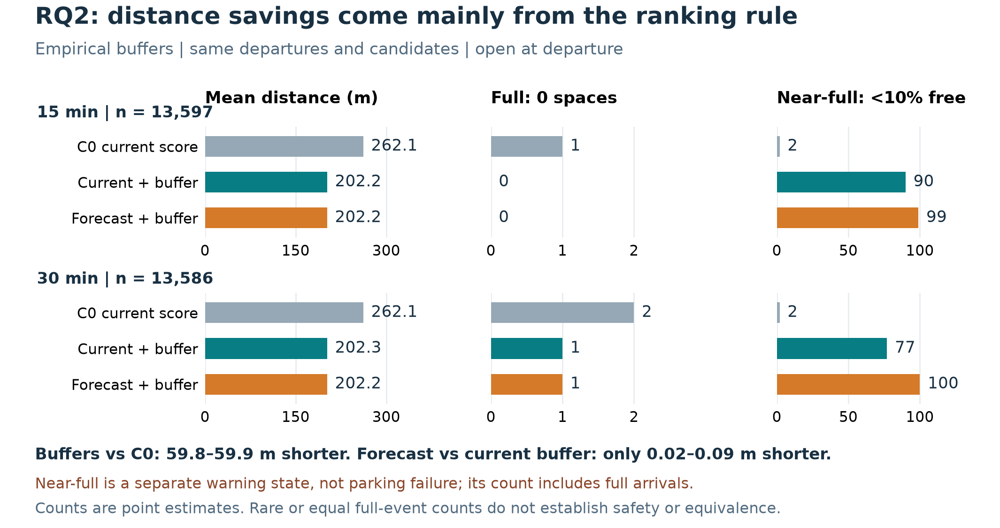

# RQ2：距离改善来自哪里？

[下载 PDF](rq2_gate.pdf) · [项目首页](../../README.md) · [完整结果与复现](../../examples/rq2_buffered_gate/README.md)

DS6004 Group 7 · 2026-11-06 · 两轮回顾性推荐规则扩展

## 01 / 规则改善明显，预测增量仍小

> 新规则相对旧 C0 平均缩短约 60 米，但相同规则下加入预测只额外缩短 0.023 / 0.089 米，满位次数没有减少。原 RQ2 不能写成“预测明显改善推荐”。

原 RQ2 比较预测占用率 C 与当前占用率 C0，评分方式相同。本次追加“达到绝对余位门槛后选最近场”的规则，并为当前和预测信号各扣除经验误差余量；旧主实验保留。

测试期 2026-06-12 至 11-04，共 146 个日期；15 / 30 分钟有 13,597 / 13,586 个共同场景。地点、8 个停车场、已训练 M1 及测试候选均沿用原标准两年运行。

新规则把距离从约 262 米降到约 202 米，同时增加选中近满场的次数。两类余量规则的距离下降与近满增加，相对 C0 均有 Holm p=0.0042。满位事件很少，未证明风险不增加。图展示收益与代价，不据此宣布全面优胜。

## 02 / 两次实验及时间隔离

### 先检查评分规则

旧分数为 0.25 × 距离/1000 + 0.75 × 占用率，因此低 1 个百分点占用率可抵消 30 米距离。即使两个场都很空，规则仍奖励更低占用率。这提供了减少距离的空间，却不一定需要预测。

| 阶段 | 固定方法 | 选择与结果 |
| --- | --- | --- |
| 1：直接余位门槛 | k=1、3、5、10、20；达标选最近 | 完整验证期内 5 个门槛全部未通过满位 / 低余位经验约束。k=3 仅保留为诊断，不能采用为改进结论 |
| 2：扣经验余量后门槛 | q=0.90、0.95、0.975、0.99；k=3、5、10、20 | 晚验证期 16 组全部经验可行；按预定最短平均距离选 q=0.90、k=3 |

第一阶段诊断中，预测门槛版相对当前门槛版，15 / 30 分钟各多 3 次满位，距离仅少约 0.005 米。失败结果与全部敏感性都保留，不根据测试结果改选门槛。

### 第二阶段如何使用历史误差

| 时间段 | 日期 | 作用 |
| --- | --- | --- |
| 早验证段 | 2026-01-17 至 03-31 | 108,338 条共同样本；按场 / 时长 / 信号计算空位高估残差 q 分位数，非负部分作为扣减余量 |
| 晚验证段 | 2026-04-01 至 06-11 | 仅用当前余量版选共享 q、k；分别约束两时长满位及少于3位事件率不高于同池 C0 |
| 测试段 | 2026-06-12 至 11-04 | 锁定参数后评价；两个边界前各隔离 30 分钟 |

两个信号使用相同校准样本与方法，但余量数值各自估计。预测余位用出发时容量计算；出发有位资格按真实当前空位判断。经验余量不是风险概率，也没有覆盖或安全保证。

晚验证段 C0 和所有当前余量组合的满位 / 低余位事件均为零，筛选证据较弱。此外两阶段的选参窗口不同，不能把“第一次失败、第二次通过”完全归因于加入余量。

## 03 / 完整结局、归因与展示用语

下表数字按 15 / 30 分钟列出。满位=0位；低余位<3位；近满<容量10%，包含满位。三者分别报告，不以近满替代失败。

| 策略 | 距离（米） | 满位次数 | 低余位次数 | 近满次数 |
| --- | --- | --- | --- | --- |
| 旧 C0 | 262.075 / 262.096 | 1 / 2 | 1 / 2 | 2 / 2 |
| 当前 + 余量 | 202.212 / 202.281 | 0 / 1 | 1 / 2 | 90 / 77 |
| 预测 + 余量 | 202.189 / 202.192 | 0 / 1 | 1 / 3 | 99 / 100 |

### 相同规则下，预测带来多少额外价值？

| 预测余量版减当前余量版 | 15 分钟 | 30 分钟 |
| --- | --- | --- |
| 平均距离差及95%区间（米） | −0.023 [−0.058, −0.001] | −0.089 [−0.154, −0.035] |
| 距离差 Holm p | 1.0000 | 0.0125 |
| 满位次数差 | 0 | 0 |
| 改变首选次数 / 场景数 | 10 / 13,597 | 36 / 13,586 |

30 分钟距离差虽可统计检出，但只有约 9 厘米。此处增量包含预测信号及其各自经验余量。95% 区间来自 percentile bootstrap，p 值来自符号翻转并另做 Holm 校正，两种构造不要求一致；15 分钟未校正 p 也为 0.1248。满位差异全零不能证明等效；30 分钟预测版还多 1 次低余位。约 60 米主要来自规则及历史余量，不能归因于预测信号。

> 可用于 Poster：A spare-space gate with empirical error buffers reduced mean straight-line distance by about 60 m versus C0, while near-full selections increased. Under the same rule, forecasting added less than 0.1 m of distance benefit and did not reduce full-at-arrival events.

统计按出发日期整块 bootstrap / 双侧符号翻转 10,000 次，第二阶段整张配对表 Holm 校正，95% 区间未校正。跨日依赖、稀少事件、已查看测试集及连续探索限制推断；本轮不是独立确认，方法搜索到此停止。未证明非劣性，不将 q=0.90 解读成 90% 安全概率。

若要进一步验证预测价值，应在新的未查看时间段，预先固定多个目的地、真实到达时长及风险 / 距离权衡，再做时间向前评估；现有结果不能保证这会带来提升。

[实验方案](../../docs/rq2_gate_protocol.md) · [第一阶段全部结果](../../examples/rq2_gate/README.md) · [第二阶段全部结果与配对统计](../../examples/rq2_buffered_gate/README.md)
