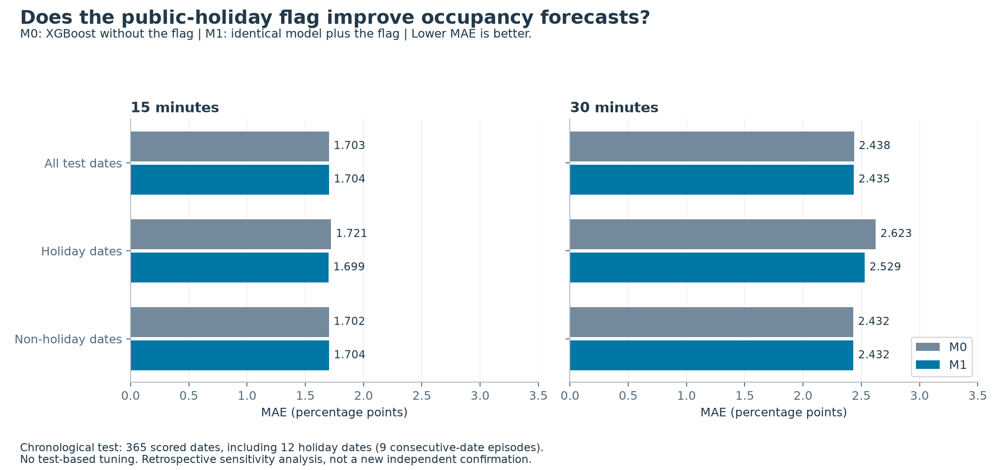
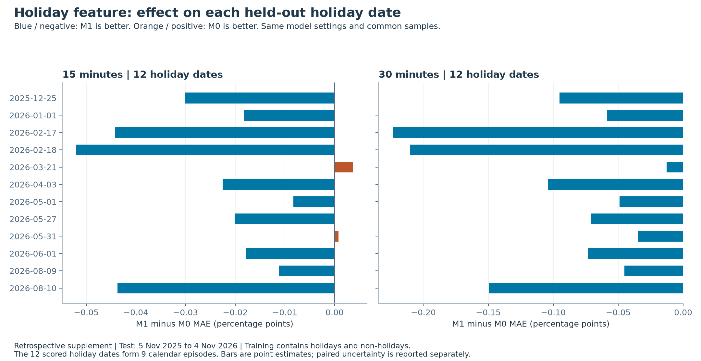
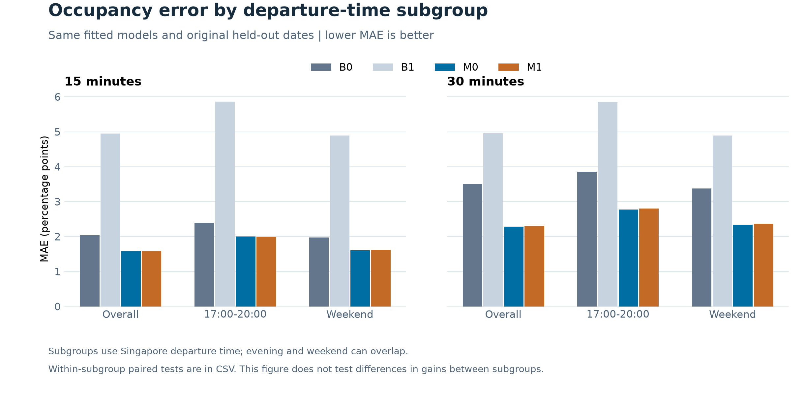
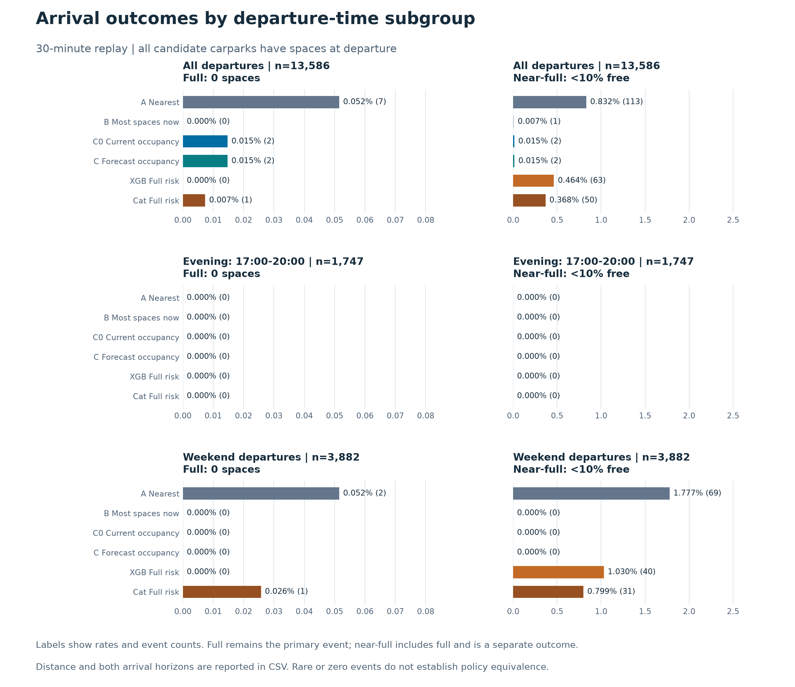

# 假日与推荐增量价值：RQ 补充测评

[下载 PDF](rq_supplement.pdf) · [项目首页](../../README.md) · [结果与复现](../../examples/rq_supplement/README.md)

DS6004 Group 7 · 2026-11-06 · 回顾性补充分析

## 01 / 加强了证据，结论仍需分开

> RQ1：在 12 个假日的测试中观察到小幅预测收益。RQ2：未发现推荐改善，晚高峰还增加了距离。

原 RQ1 比较 M1（加入假日标记）与 M0；RQ2 比较 C（预测占用率排名）与 C0（同规则、当前占用率排名）。本次保留原主实验，新增完整后一年假日测试，并对现有标准两年输出补做晚高峰和周末分析。

| 新假日实验分段 | 日期范围 | 假日日期数 |
| --- | --- | --- |
| 训练 | 2024-11-05 至 2025-09-04 | 11 |
| 验证 | 2025-09-05 至 2025-11-04 | 1 |
| 测试 | 2025-11-05 至 2026-11-04 | 12 |

两边界前各隔离 30 分钟，训练同时包含假日与非假日。只重训 M0 / M1 × 15 / 30 分钟四个回归模型，参数固定，不根据新结果调参。验证段保留，不回填训练。

假日 MAE 分别下降 **1.28% / 3.58%**；总体 15 分钟误差反而微升，30 分钟微降但多重校正后不显著。可以支持“假日标记在这个假日测试窗口有小幅增量价值”，不能写成总体全面改善。

本数据 730 天实际有 24 个假日日期，不是 44 个。不能采用“全部非假日训练、全部假日测试”：那会让训练中的假日标记恒为 0，并让后期数据进入早期测试的训练集。

[固定方案与评估边界](../../docs/rq_supplement_protocol.md) · [模型指标](../../examples/rq_supplement/holiday/forecast_metrics.csv)

## 02 / RQ1：假日增益小，但跨日更一致

> 测试覆盖 12 个假日日期、9 组连续假日；这些日期或分组才是统计重采样单位。

| 时长 | 假日 MAE：M0 → M1 | 相对下降 | Holm p：按日 / 按组 |
| --- | --- | --- | --- |
| 15 分钟 | 1.7210 → 1.6990 | 1.28% | 0.0080 / 0.0204 |
| 30 分钟 | 2.6233 → 2.5293 | 3.58% | 0.0036 / 0.0152 |

MAE 单位为占用率百分点；对应绝对减少约 **0.0220 / 0.0940 个百分点**。共同样本为 9,013 / 8,916 个停车场与时点，不能把这些行当成独立假日。15 分钟有 10/12 日期改善，30 分钟为 12/12。

主分析按到达目标日期分块；敏感性分析将春节、卫塞节及补假、国庆及补假的连续日期合并，得到 9 组。按组的 M1−M0 差值 95% 区间约为 **[-0.0328, -0.0113] / [-0.1408, -0.0554]** 个百分点。两种口径方向一致。

均重采样 10,000 次，使用双侧块符号翻转检验。按日表的 12 项比较与按组表的 4 项比较分别做 Holm 校正；区间未校正。小样本、跨组相关性及符号对称假设仍限制推断。

这是已有数据上的回顾性补充，改变了训练与测试窗口，不能据此认定之前不显著完全由假日少造成。结论限于这套模型与二元假日特征，仍需未使用日期确认。

[逐日结果](../../examples/rq_supplement/holiday/holiday_daily_metrics.csv) · [按日检验](../../examples/rq_supplement/holiday/paired_holiday_comparisons.csv) · [连续假日分组检验](../../examples/rq_supplement/holiday/holiday_episode_comparisons.csv)

## 03 / 晚高峰与周末：增益点估计低于总体

> 预测仍优于当前状态基准，但子组的相对改善点估计低于总体。

以下复用原标准两年测试期（2026-06-12 至 2026-11-04）的拟合模型，不重训。晚高峰固定为每天出发时刻 17:00 ≤ t < 20:00，周末为周六与周日，二者可以重叠。

| 子组 | 15 分钟共同样本 | 30 分钟共同样本 | M0 对 B0 的降幅（15 / 30） |
| --- | --- | --- | --- |
| 全体，146 天 | 108,820 | 107,632 | 22.3% / 34.5% |
| 晚高峰，146 天 | 13,989 | 13,988 | 16.8% / 28.0% |
| 周末，42 天 | 31,106 | 30,752 | 18.9% / 30.5% |

这六项 M0−B0 在各子组内均达到 Holm p 约 0.0012；但我们没有做子组间的交互检验，不能据此声称某组的增益显著大于或小于另一组。也不能预先写“晚高峰 / 周末表现更突出”。

M1 对 M0 的增量仍有限：晚高峰 15 分钟接近持平、30 分钟略差，周末两个时长均略差。假日与周末是不同概念，不能用周末结果替代假日特征检验。

overall 的样本数与所有指标已核对，完全复现旧主实验。由于本次整张配对表的检验集合不同，校正 p 值可能与旧报告不同，效应估计保持一致。

[子组预测指标](../../examples/rq_supplement/subgroups/forecast_metrics.csv) · [子组配对统计](../../examples/rq_supplement/subgroups/paired_forecast_comparisons.csv)

## 04 / RQ2：距离代价暴露了推荐局限

> 晚高峰无观察到的停车风险收益，C 相比 C0 平均增加约 13 / 28 米直线距离。

| 30 分钟子组 | 场景数 | 满位次数 C0 / C | 距离差 C−C0（米） |
| --- | --- | --- | --- |
| 全体 | 13,586 | 2 / 2 | -0.58 |
| 晚高峰 | 1,747 | 0 / 0 | +27.50 |
| 周末 | 3,882 | 0 / 0 | -0.28 |

晚高峰各策略的满位、少于 3 个空位、近满次数均为 0；C 的 15 / 30 分钟距离增加 **12.81 / 27.50 米**，Holm p 均约 0.0078。周末 C−C0 的距离差不显著。零事件不能证明策略等效。

真正满位仍为主要事件；低余位与近满为单独次要结果。两种候选口径、全部策略、首选变更率及两个时长均保留在 CSV。近满不能替代失败，也不能因子组结果更有利而更换主要结局。

[推荐完整结果](../../examples/rq_supplement/subgroups/recommendation_metrics.csv) · [配对统计](../../examples/rq_supplement/subgroups/paired_policy_comparisons.csv) · [复现与限制](../../examples/rq_supplement/README.md)
